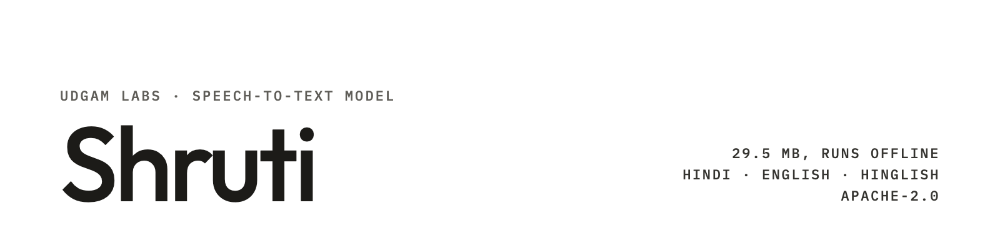

**UDGAM LABS** · Speech-to-text model · 55M parameters

# Shruti

**Shruti turns Hindi, English and Hinglish speech into text, offline, from one 29.5 MB file.** Hindi comes out in
Devanagari and English words stay in English, the way people actually type Hinglish: *मेरा order कब आएगा*. It runs on a
phone, a laptop or inside a web page, with no server and no internet connection. On a 2021 Samsung Galaxy F62 it
transcribes a sentence in about a second using 80 MB of memory.

Shruti is built on [Cactus Whistle](https://huggingface.co/Cactus-Compute/whistle) (Apache-2.0): we retrained all 55M
weights on 2,732 hours of openly licensed Indian speech and added 714 Devanagari vocabulary pieces. The weights are on
Hugging Face; this repository has runnable examples (Python, command line, a web page), the full comparison and
checksums.

*Shruti* (श्रुति) is Sanskrit for "that which is heard".

[Model card](https://huggingface.co/udgamlabs/Shruti) · [Try it in your browser](https://udgamlabs.com/models/shruti) · [Demo on Hugging Face](https://huggingface.co/spaces/udgamlabs/Shruti) · [Technical report](https://udgamlabs.com/research/shruti) · [udgamlabs.com](https://udgamlabs.com)

| | |
|---|---|
| Developer | Udgam Labs |
| Base model | Cactus Whistle (Cactus Compute), Apache-2.0 |
| Parameters | 55M (8 encoder + 8 decoder layers, width 512) |
| Files | `shruti.cact`, 29.5 MB (4-bit weights, 8-bit activations) for the Cactus needle engine; `shruti.safetensors`, 222 MB (full-precision fp32 weights, config in the file's metadata) |
| Input / output | 16 kHz audio of any length → text; Hindi in Devanagari, English words in lowercase Latin |
| Languages | Hindi, English, Hinglish (code-mixed). Whistle's other languages (German, French, Spanish, Italian, Dutch, Polish) were not evaluated and are probably weaker after our training |
| Runtime | [Cactus needle](https://huggingface.co/Cactus-Compute/needle3) engine (Apache-2.0): macOS, Linux, Windows, Android, iOS, WebAssembly |
| Licence | Apache-2.0 |

## Get started

**Python** (macOS, Linux, Windows):

```bash
pip install cactus-needle
python examples/transcribe.py clip.wav
```

```python
from huggingface_hub import hf_hub_download   # installed with cactus-needle
from needle import Whistle

model = Whistle(hf_hub_download("udgamlabs/Shruti", "shruti.cact"))
print(model.transcribe("clip.wav"))                    # the language is detected automatically
# {'text': 'side में menu card रखा हुआ है और bike की चाबी भी रखी हुई है', 'language': 'hi', ...}
print(model.transcribe("english.wav", language="en"))  # only for speech that is all English (see below)
```

`transcribe` also takes `keywords=[...]` (names or terms to favour) and `word_timestamps=True`. On first use the package
downloads Cactus's engine library from Hugging Face and caches it. The `cactus-needle` Python package sends anonymous
usage counts (function name, versions, OS) by default; `examples/transcribe.py` sets `NEEDLE_TELEMETRY=0` to turn that
off. The command-line engine and the WebAssembly build make no network calls.

**Command line** (macOS on Apple silicon, Linux x86_64 or arm64; no Python):

```bash
./examples/transcribe.sh clip.wav                          # language detected automatically
./examples/transcribe.sh talk.wav --audio-stream           # live, word by word
./examples/transcribe.sh english.wav --audio-language en   # all-English speech
```

The script downloads the `needle` binary for your platform from
[Cactus-Compute/needle3](https://huggingface.co/Cactus-Compute/needle3) at a fixed revision and `shruti.cact` from
Hugging Face, checks both SHA-256 hashes, and runs `needle --model shruti.cact --audio clip.wav`. On Windows, download
`windows-x86_64/needle.exe` from the same repository and run that command directly.

**In the browser:** [`examples/browser/`](examples/browser/) is a single page with no build step and no dependencies. It
runs the engine's WebAssembly build in a Web Worker, downloads `shruti.cact` from Hugging Face once, keeps it in the
browser's Cache Storage, and transcribes an audio file or the microphone entirely on the device.

```bash
cd examples/browser && python3 -m http.server 8000   # then open http://localhost:8000
```

The microphone needs a secure page: `http://localhost` or `https`. A working page is at
[udgamlabs.com/models/shruti](https://udgamlabs.com/models/shruti).

**In an app (Android, iOS):** link the engine's C library (`needle.h`: `needle_load`, `needle_transcribe`,
`needle_stream_transcribe_process`) and ship `shruti.cact` with the app. Use 2 threads on phones with two fast cores.

**Language setting.** Leave the language unset: automatic detection scores the same as setting it on Hindi, Hinglish,
accented Hindi and US English. Set `en` only for speech that is entirely English with an Indian accent, which detection
often treats as Hindi (Svarah subset: 21.1 with `en` vs 25.8 detected).

| Example | What it shows |
|---|---|
| [`examples/transcribe.py`](examples/transcribe.py) | Python: download, verify and transcribe a WAV file |
| [`examples/transcribe.sh`](examples/transcribe.sh) | the `needle` command-line engine, with checksums, no Python |
| [`examples/browser/`](examples/browser/) | a web page that transcribes files and the microphone in the browser (WebAssembly) |

To check the model files against [`SHA256SUMS`](SHA256SUMS):

```bash
hf download udgamlabs/Shruti shruti.cact shruti.safetensors --local-dir Shruti
shasum -a 256 -c SHA256SUMS      # or: sha256sum -c SHA256SUMS
```

## How it works

```
audio (any rate) → 16 kHz mono samples → needle engine (C, or WebAssembly in a browser)
                                           └─ Shruti: speech encoder → text decoder (55M, 4-bit) → text + language
```

Shruti is an encoder-decoder speech model: the encoder turns 80 ms frames of audio into features and the decoder writes
the transcript one word piece at a time, starting with a language tag (`hi` or `en`). The `.cact` file holds the
weights in 4 bits with 8-bit activations, which is how the whole model fits in 29.5 MB. Long audio is processed in 30 s
windows. A streaming mode takes about a second of audio at a time and commits words as they become stable.

## Results

Word error rate (%, lower is better). Every model was run by us on the same test sets with the same text normaliser and
scorer (Monsoon uses the official OIWER lattice scorer of the Hugging Face Open ASR leaderboard). Shruti was run in the
on-device engine (5-beam, language set); the other models on a GPU or a Mac with the decoding settings listed in
[docs/comparison.md](docs/comparison.md), which also has exact versions and two more Hinglish models. Measured
2026-10-18/19. n/c: not comparable (the model writes Roman script only); –: not measured.

| Model | File size | Monsoon Hindi | FLEURS Hindi | Lahaja (Hindi accents) | MUCS Hinglish | Svarah (Indian English) | LibriSpeech (English) | Words invented on 100 silent clips |
|---|---|---|---|---|---|---|---|---|
| **Shruti** | **29.5 MB** | 20.46 | 19.92 | 26.28 | **35.21** | 22.47 | 5.95 | 0 |
| [Koyal-hi-120M](https://huggingface.co/adalat-ai/koyal-hi-120m-1.0) | 481 MB | **11.64** | **9.56** | 18.70 | 57.51 | Hindi only | Hindi only | 0 |
| [IndicConformer Hindi](https://huggingface.co/OpenVoiceOS/ai4bharat-indicconformer-hi-onnx) (fp32) | 482 MB | 15.31 | 11.31 | **13.18** | 64.48 | Hindi only | Hindi only | 88 |
| [Vosk small Hindi + Indian English](https://alphacephei.com/vosk/models) | 139 MB | 35.75 | 18.07 | 26.60 | 61.14 | 38.51 | 30.18 | 1 |
| [Whisper-Hindi2Hinglish-Swift](https://huggingface.co/Oriserve/Whisper-Hindi2Hinglish-Swift) | 296 MB | 57.16 (Roman script) | n/c | n/c | n/c | 20.16 | 12.60 | 1,676 |
| [Whisper-small](https://huggingface.co/openai/whisper-small) | 971 MB | 128.25 | 59.42 | 117.5 | – | – | – | – |
| [Whisper large-v3](https://huggingface.co/openai/whisper-large-v3) (fp16) | 3,087 MB | 33.29 | 28.88 | 31.19 ¹ | 79.94 ¹ | **7.39** ¹ | **2.25** ¹ | 538 |

¹ Whisper large-v3 (1.55B parameters; fp16 on a Mac GPU, beam 5, language set) on the first 300 Lahaja, Svarah and
LibriSpeech clips and the first 600 MUCS clips; Shruti on the same clips: 22.87, 21.35, 5.76 and 45.3. On Monsoon and
FLEURS both ran on every clip; in that run Shruti scored 20.46 and 20.14 (FLEURS with the newest engine build; 19.92 in
the table is the build of 18 October).

- **Hinglish:** Shruti has the lowest Hinglish word error rate of the open models we measured (MUCS 2021, same harness),
  and it stays ahead when both sides are converted to Roman script (34.32 vs 43.45 and 44.94 for whisper-base-hinglish
  and whisper-tiny-hinglish-v2; with the most forgiving converter the lead is narrow, 31.37 vs 32.66 and 34.22). Details
  in [docs/comparison.md](docs/comparison.md).
- **Whisper large-v3:** Shruti is 100× smaller than OpenAI's Whisper large-v3 (29.5 MB vs 3,087 MB), and more accurate
  on Hindi on the same clips: Monsoon 20.46 vs 33.29, FLEURS 20.14 vs 28.88, Lahaja 22.87 vs 31.19 (first 300 clips).
  Whisper is far better on English: Svarah 7.39 vs 21.35 and LibriSpeech 2.25 vs 5.76 (first 300 clips each). Whisper
  ran with plain beam search, without its temperature fallback, which causes some repetition loops; with those clips
  removed Shruti still leads on Hindi (FLEURS 19.9 vs 26.4, Lahaja 22.9 vs 28.7). The leaderboard's own Whisper large-v3
  Monsoon number (28.17, its decoding) is also behind Shruti's 20.46.
- **Monsoon** is the public split of the Hindi test set used by the Hugging Face Open ASR leaderboard. Published
  leaderboard numbers for context: Whisper large-v3 28.17 (1.55B parameters), Voxtral Mini 3B 22.9, Qwen3-ASR-0.6B
  18.13, IndicConformer-600M 8.47. Shruti has not been submitted to the leaderboard, so it has no official rank, and the
  full test set may score a few points differently from the public split.
- **MUCS** (Hindi-English code-mixed lectures): references mostly write English words in Latin script, as Shruti does.
  Models that write English in Devanagari, or everything in Roman script, are penalised on it; that is the Hinglish skill.

**Speed and memory** (offline):

| Device | Result |
|---|---|
| Samsung Galaxy F62 (Exynos 9825, 6 GB RAM, Android 13), 2 threads | a ~7 s sentence in ~1 s including model load; 60 s of audio in 9.5 s (6.3× real time); peak memory 80 MB |
| Web browser engine (WebAssembly, one thread, Node on Apple M-series) | a 9.6 s clip in 0.45 s; transcripts identical to the native engine |
| Hugging Face Space (shared 2-core CPU) | a 2.8 s clip in 0.35 s |

On the phone, 42 of 51 test transcripts were identical to the Mac's; the rest differed by a letter or two. Raw numbers:
[docs/shruti_on_device.json](docs/shruti_on_device.json), [docs/phone_benchmark.json](docs/phone_benchmark.json).

## Where it falls short

- **Pure Hindi accuracy.** Hindi-only models about 16× larger are far more accurate: Koyal-hi-120M makes roughly half
  as many errors on Monsoon and FLEURS, and IndicConformer half as many on accented Hindi (Lahaja). Choose them if you
  only need Hindi and have the memory.
- **English.** OpenAI's Whisper large-v3 (100× larger) is far more accurate on English: on the same clips, Svarah 7.39
  vs 21.35 and LibriSpeech 2.25 vs 5.76. On Indian-accented English Shruti (Svarah 22.5) is also behind
  Whisper-Hindi2Hinglish-Swift (20.2), which is 10× larger and writes Hindi in Roman script only.
- **Spelling and grammar look-alikes**: है/हैं, मैं/में, की/के, and formal versus spoken forms (पे → पर, वो → वह) are common
  errors.
- **Names it has never heard** are spelt by sound: in our own phone test it wrote its name, Shruti, as "सूती" and
  "shooty", and Udgam Labs as "outgum labs". Rare names and technical terms are often misheard; pass them as
  `keywords` to help.
- **Noise and music** were not tested; only silent clips (0 invented words on 100 clips of digital silence and very
  faint hiss). Long audio is processed in 30 s windows.
- Numbers are written as words, the way they are spoken. There is no punctuation or capitalisation.
- **Platforms:** we measured Shruti on a Mac (Apple silicon), Linux (x86), an Android phone and WebAssembly. The engine
  also runs on Windows and iOS, but we have not tested Shruti there.

## How it was trained

- **Start:** Cactus Whistle (55M, Apache-2.0), trained by Cactus Compute on European languages. We added 714 Devanagari
  vocabulary pieces and a Hindi language tag, then trained **all** weights (not an adapter) with 4-bit quantisation-aware
  training, so the exported 29.5 MB file behaves like the trained model.
- **Data:** 2,732 hours of speech, every source licensed for commercial use. English
  words in Hindi transcripts are written in Latin script using each dataset's own annotations (for example AI4Bharat's
  `[english]` tags in IndicVoices). Test sentences were removed by text and audio hash.
- **Recipe:** one spelling per word for training targets; trained from Whistle's weights, then continued with more
  Indian English.

The [technical report](https://udgamlabs.com/research/shruti) describes the vocabulary extension, the training method,
the data and the evaluation in full, with the source of every number.

### Data credits

Shruti was trained on these openly licensed datasets. We are grateful to their creators; please credit them if you
build on this work.

| Source | Licence |
|---|---|
| AI4Bharat IndicVoices, Hindi | CC-BY-4.0 |
| ARTPARK-IISc Vaani, Hindi (transcribed train split) | CC-BY-4.0 |
| AI4Bharat Shrutilipi, Hindi | CC-BY-4.0 |
| AI4Bharat Kathbath, Hindi | CC-BY-4.0 |
| AI4Bharat Rural Women ASR v2, Hindi | CC-BY-4.0 |
| Google FLEURS, Hindi train split | CC-BY-4.0 |
| MUCS 2021 Hindi-English (via dianavdavidson/MUCS-Hinglish) | CC-BY-4.0 on the card; the original corpus is CC-BY-SA-4.0 |
| AI4Bharat NPTEL (Indian-English lectures) | CC-BY-4.0 |
| Mozilla Common Voice 17, English with Indian / South Asian accents | CC0 |
| LibriSpeech | CC-BY-4.0 |

## Intended use

For transcribing Hindi, English and Hinglish speech on devices where privacy, cost or connectivity rule out a cloud
service: voice notes, dictation, voice commands, captions, field apps. Not for high-stakes use (medical, legal) without
human review. Accuracy drops on noisy audio, strong accents, rare names and long technical English.

## Licence

Apache-2.0 for the weights and everything in this repository. Shruti is a modified version of Cactus Whistle by Cactus
Compute (Apache-2.0); see [`NOTICE`](NOTICE). The browser example includes the unmodified WebAssembly build of the Cactus
needle engine (Apache-2.0), with its licence and notice in
[`examples/browser/needle/`](examples/browser/needle/). The training data licences are listed above.

## Citation

```bibtex
@techreport{udgamlabs2026shrutireport,
  title       = {Shruti: offline speech-to-text for Hindi, English and Hinglish in 29.5 MB},
  author      = {{Udgam Labs}},
  institution = {Udgam Labs},
  type        = {Technical report},
  year        = {2026},
  url         = {https://udgamlabs.com/research/shruti}
}
```

---

**About Udgam Labs.** Udgam Labs is an independent AI research lab. We work from first principles: before we build, we understand why things work, whether we are training a model, fine-tuning one or applying AI to a new problem. Udgam (उद्गम) is Sanskrit for origin. [udgamlabs.com](https://udgamlabs.com)
